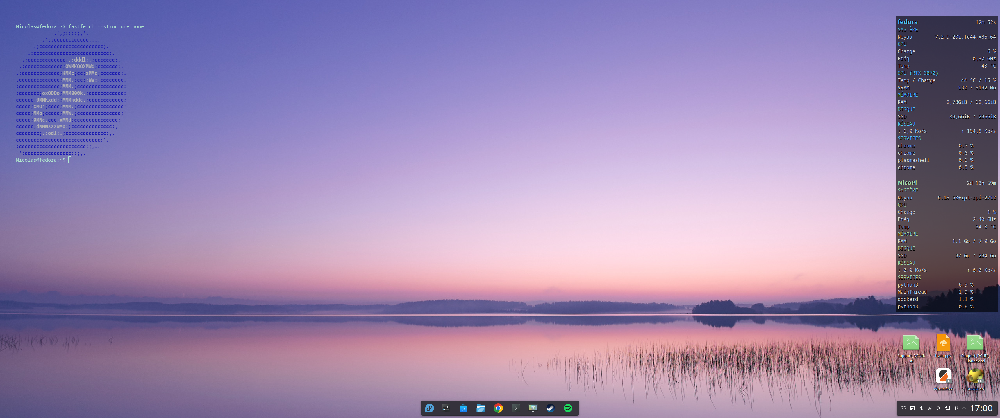

# DeskTerm

A real Konsole melted into your KDE Plasma wallpaper — no widget, no hack, just a blinking cursor always ready on your desktop.



It's a regular Konsole window pinned to the desktop by a KWin rule: borderless, always below other windows, hidden from the taskbar and Alt+Tab, with a fixed position and size. When its background matches the wallpaper, the window simply disappears and only the prompt is left floating.

## Requirements

- KDE Plasma 6 (Wayland or X11)
- Konsole
- bash (for the colored prompt; the terminal itself works with any shell)

Tested on Fedora 44 KDE.

## Install

```bash
git clone https://github.com/NicoPi-dev/deskterm.git
cd deskterm
bash install.sh
```

DeskTerm starts right away and at every login.

- `Meta+Enter` jumps into the terminal, even when windows cover it
- `deskterm` relaunches it if you closed it with `exit`

If a Konsole toolbar shows up, right-click it and uncheck the toolbars.

## Customize

Edit the settings at the top of `install.sh`, then run it again:

| Setting | Default | What it does |
|---|---|---|
| `W`, `H` | `540`, `760` | Window size |
| `X`, `Y` | `40`, `56` | Top-left corner position |
| `FONT` | `Monospace,13` | Font and size |
| `BG` | `0,0,0` | Background color (RGB) |
| `OPACITY` | `1` | `1` = solid, `0` = fully transparent |
| `FG` | `178,234,205` | Text and prompt color (RGB) |
| `SHORTCUT` | `Meta+Return` | Focus shortcut |

**Two ways to make it invisible:**

1. **Solid background (default)** — use a wallpaper that is pure black (`#000000`) behind the terminal. Perfectly readable. A matching black → mint gradient wallpaper (3440×1440) is in [`assets/`](assets/).
2. **Fully transparent** — set `OPACITY=0` to use it on any wallpaper. Konsole can't draw a shadow behind text, so pick a text color that contrasts with that area of your wallpaper.

## Uninstall

```bash
bash uninstall.sh
```

Removes the profile, color scheme, prompt, KWin rule, launcher and autostart entry. Your other Konsole profiles are not touched.

## How it works

| Piece | File |
|---|---|
| Konsole profile (fixed title, blinking cursor, no scrollbar, no scrolled-lines highlight bar) | `~/.local/share/konsole/DeskTerm.profile` |
| Color scheme | `~/.local/share/konsole/DeskTerm.colorscheme` |
| KWin rule matching the title "DeskTerm" | `~/.config/kwinrulesrc` |
| Colored prompt, only when `DESKTERM=1` | `~/.bashrc.d/deskterm.sh` |
| Launcher | `~/.local/bin/deskterm` |
| Autostart | `~/.config/autostart/deskterm.desktop` |

## License

MIT
